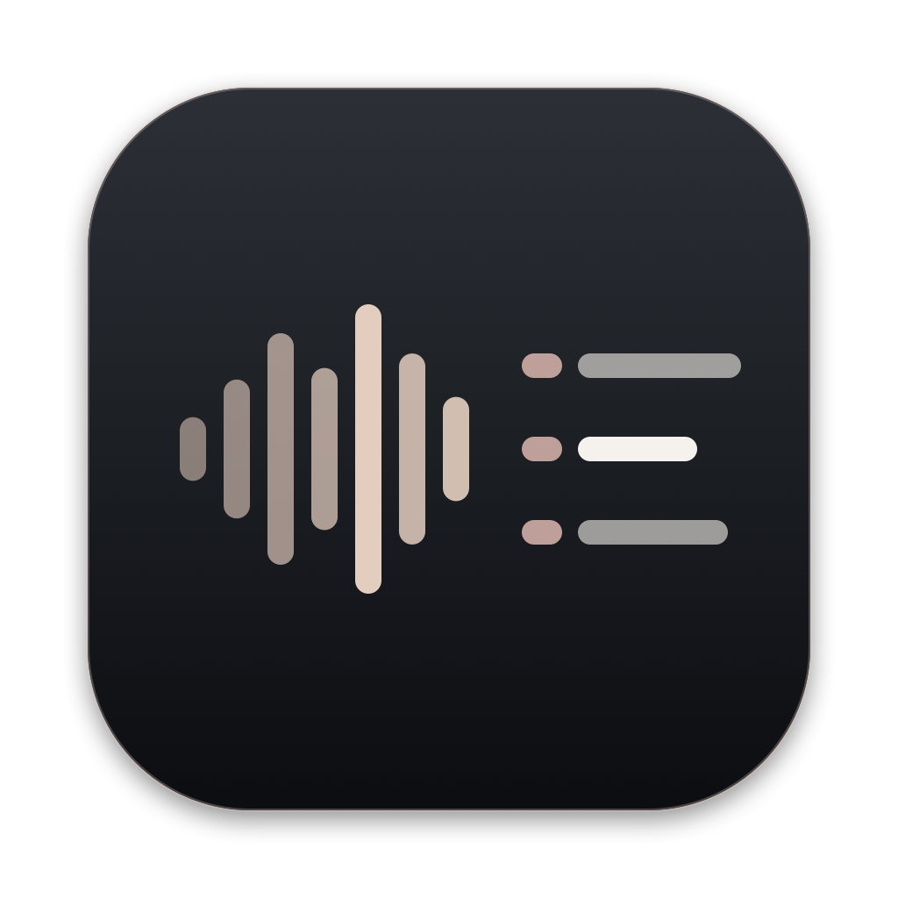
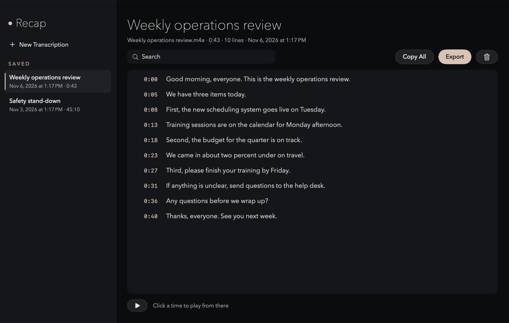
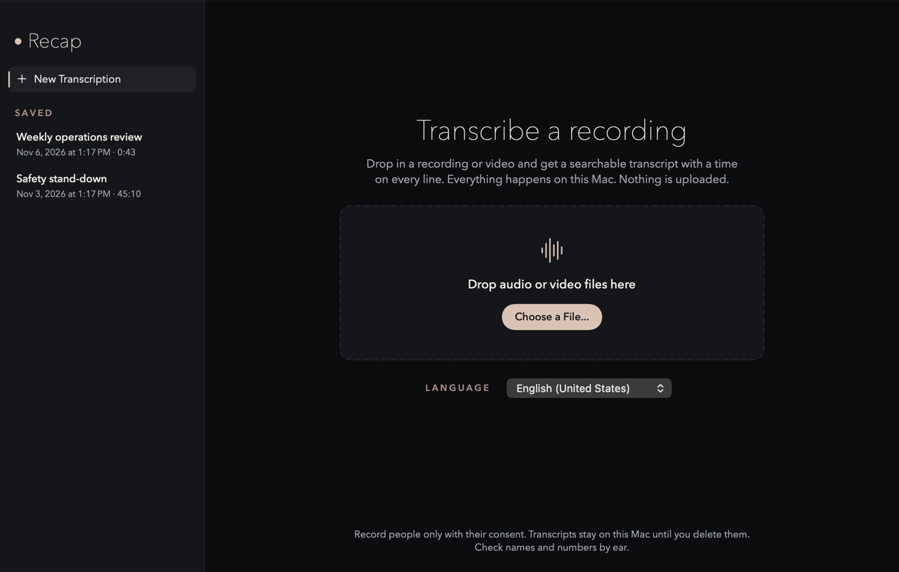
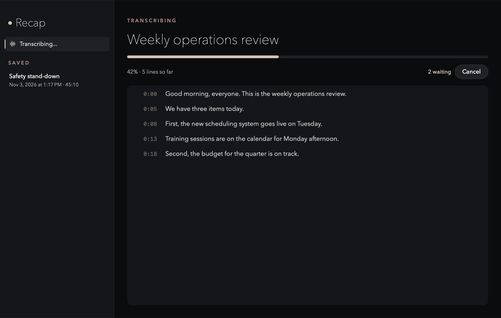

<p align="center"></p>

# Recap

A private Mac app that turns a recording into a searchable transcript, with a time on every line.
Everything happens on your Mac. Nothing is uploaded.

**[Download Recap for Mac](https://github.com/KevinPlanet9/recap/releases/latest/download/Recap.zip)** (macOS 26 or later)



Drop in a meeting recording, a voice memo or a video. Recap listens with Apple's own on-device
speech engine and gives you a transcript you can search, copy and export. Click any time to hear
that moment in the recording.

## What it does

- **On your Mac only.** Apple's speech engine runs on the Mac. Recap has no network access at all:
  macOS's App Sandbox blocks it. Your recordings are never copied or uploaded.
- **Fast.** On an M5 MacBook Pro, a 4 hour recording takes about 2 minutes.
- **Every voice.** Meeting and screen recordings often keep you and the other people on separate
  tracks. Recap mixes every sound track, so nobody is left out.
- **Search.** Type a word or two to see only the lines that have them. Accents and capitals don't matter.
- **Play from any line.** Click a time to play the recording from there. The line playing is highlighted.
- **Export.** Plain text, Markdown, subtitles (SRT and WebVTT), or JSON. Or Copy All.
- **Kept until you delete it.** Transcripts are saved on the Mac and listed in the sidebar until you delete them.
- **A queue.** Drop several files at once; Recap does them one after another and shows how many are waiting.

## Getting started

### 1. Install

1. [Download Recap.zip](https://github.com/KevinPlanet9/recap/releases/latest/download/Recap.zip) and open it.
   Drag **Recap** to your Applications folder.
2. Open Recap. macOS says it was blocked, because it isn't signed with a paid Apple developer
   certificate. Click **Done**.
3. Open System Settings > Privacy & Security, scroll down to Security, and click **Open Anyway** next to
   "Recap" was blocked.
4. In the box that pops up, click **Open Anyway** again (not Move to Trash), then confirm with your
   password or Touch ID. You only do this once.

**Or build it yourself,** which takes about a minute and skips the warning. You need macOS 26 or later
and the Xcode Command Line Tools (run `xcode-select --install` once) or Xcode. Then in Terminal:

```bash
git clone https://github.com/KevinPlanet9/recap.git
cd recap
scripts/build-app.sh --install
```

That puts **Recap** in the Applications folder in your home folder.

### 2. Transcribe



Drop a recording or video on the window, click **Choose a File**, or right-click a file in Finder and
choose Open With > Recap. Pick the language first if it isn't English.

The first time you use a language, macOS downloads its speech model. That needs the internet once;
after that it works offline.



While it works you see the progress, the lines as they arrive, and how many files are waiting.
**Cancel** stops everything. Your Mac stays awake until it's done.

### 3. Use the transcript

- **Search** at the top filters the lines.
- **Click a time** to play from there. If the recording has moved or been deleted, Recap says so.
- **Copy All** copies the words. **Export** saves a file in the format you pick.
- **The trash button** deletes the transcript after asking. The recording itself is never touched.

## Good to know

- **Check names and numbers by ear.** Like any speech recognition, Recap can mishear them.
- **No speaker labels yet.** Lines aren't marked with who said them.
- **Ask first.** Record people only with their consent, and follow your company's rules for keeping recordings.
- **Silence.** If Recap hears no speech, it says "No speech found" and saves nothing.
- **Needs macOS 26 or later**, on a Mac that supports Apple's on-device speech engine.

## Updating

Recap doesn't check for updates by itself (it has no network access). To update, download
[Recap.zip](https://github.com/KevinPlanet9/recap/releases/latest/download/Recap.zip) again, quit
Recap, and replace the old copy in Applications. Your saved transcripts stay where they are.

## Privacy and security

See [SECURITY.md](SECURITY.md) for each privacy control and where it lives in the code.

## For developers

See [docs/MAINTAINING.md](docs/MAINTAINING.md) for building, testing and publishing a release, and
[docs/BUILD-LOG.md](docs/BUILD-LOG.md) for what changed and how it was checked.

## License

MIT. See [LICENSE](LICENSE).
